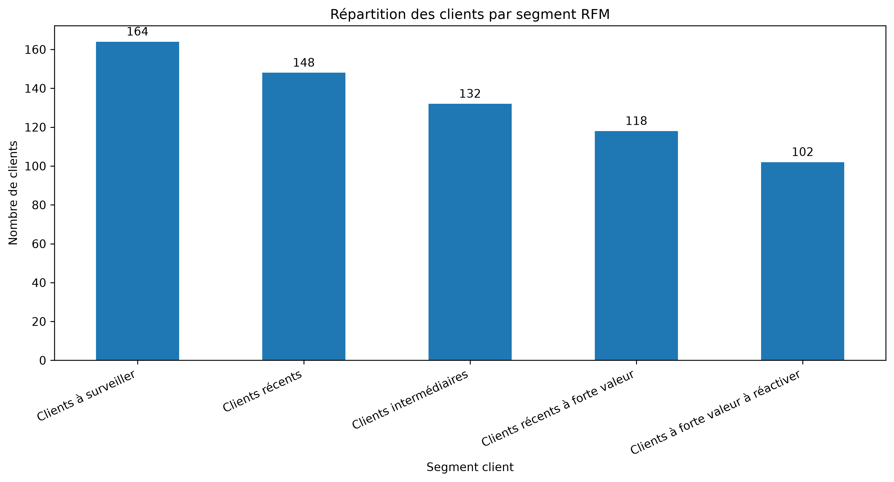

# ChurnGuard Customer Analytics

Projet d’analyse et de prédiction du churn client.

## Structure

- `data/raw/` : CSV originaux, non versionnés
- `data/processed/` : données préparées, non versionnées
- `ingestion/` : scripts Python d’importation
- `notebooks/` : analyses exploratoires
- `tests/` : tests du projet

## Installation

Créer un environnement virtuel puis installer les dépendances :

```bash
python -m venv .venv
```

Activer l’environnement virtuel et installer les dépendances :

```bash
pip install -r requirements.txt
```
## Analyse RFM — Segmentation des clients

### Objectif

L'analyse RFM permet de segmenter les clients selon trois indicateurs :

* **Récence (R)** : nombre de jours depuis la dernière commande.
* **Fréquence (F)** : nombre de commandes livrées.
* **Montant (M)** : montant total des articles achetés.

Chaque indicateur reçoit un score de 1 à 5. Un score élevé en récence correspond à une commande plus récente, tandis qu'un score élevé en fréquence ou en montant indique davantage de commandes ou de dépenses.

### Résultats

L'analyse porte sur **664 clients** ayant passé au moins deux commandes livrées pendant la période d'observation de 180 jours se terminant le 31 décembre 2017.

| Segment                            | Nombre de clients |
| ---------------------------------- | ----------------: |
| Clients à surveiller               |               164 |
| Clients récents                    |               148 |
| Clients intermédiaires             |               132 |
| Clients récents à forte valeur     |               118 |
| Clients à forte valeur à réactiver |               102 |
| **Total**                          |           **664** |

### Visualisation



### Interprétation

Les clients récents à forte valeur présentent un montant moyen d'achats de 451,31 BRL. Les clients à forte valeur à réactiver affichent un montant moyen de 420,60 BRL, mais leur dernière commande remonte en moyenne à environ 121 jours.

Ces résultats permettent d'identifier des profils auxquels une entreprise pourrait adapter ses actions de fidélisation et de réactivation.

### Limites

Cette segmentation est descriptive et repose sur une période historique limitée. Elle ne prouve pas qu'un client a définitivement abandonné la plateforme et ne constitue pas encore un modèle prédictif de churn.
